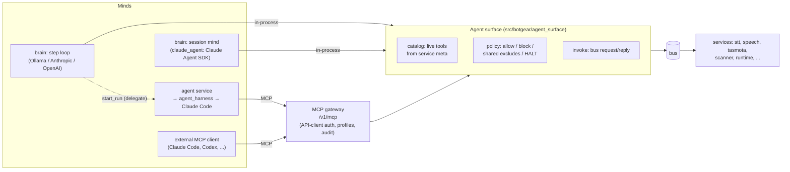
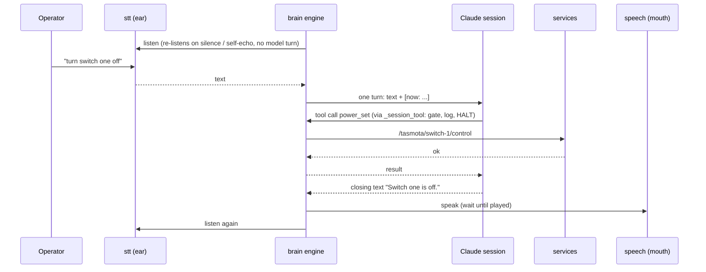

# How AI agents drive botgear (current architecture)

How brain, the agent service, the MCP gateway and agent_harness fit together
**today**: what each piece is, how a request flows through them, and where
the safety rules live. Written 2026-10-04, after roadmap Phases 0–4 were all
validated live.

This is the "how it works now" document. [`AGENT_ROADMAP.md`](AGENT_ROADMAP.md)
is the plan and history (why it was built this way, measurements, what's
next); the component READMEs have the details:

| Doc | Read it for |
|---|---|
| [`repo/brain/1.0.0/README.md`](../repo/brain/1.0.0/README.md) | brain workflows, every `workflow.yaml` field, bus actions, model adapters |
| [`repo/brain/1.0.0/README_ENGINE.md`](../repo/brain/1.0.0/README_ENGINE.md) | `WorkflowEngine` internals: the loop, session minds, termination, guards |
| [`repo/agent/1.0.0/README.md`](../repo/agent/1.0.0/README.md) | the agent service: setup, bus actions, `robot-health` |
| [`src/botgear/mcp_gateway/README.md`](../src/botgear/mcp_gateway/README.md) | connecting an external agent, tools, profiles, audit |
| [`packages/agent_harness/README.md`](../../../packages/agent_harness/README.md) | the harness: workflows, skills, drivers, checks |

---

## The short version

botgear is a bus of services (mic, speech, switches, scanner, ...). Every
service describes its own actions on the bus. **Anything that wants to act
on the robot (a "mind") goes through one shared layer, the agent surface,
which discovers those actions, applies one safety policy, obeys HALT and
logs every call.** There are three kinds of mind, for three kinds of work:

| | brain | agent service | external agent |
|---|---|---|---|
| What it is | in-process service running folder-defined **workflows** | in-process service running **agent_harness** workflows | any MCP client: Claude Code, Codex, Claude desktop |
| The mind | a local model (Ollama, default) step by step, or a rented Claude session (`claude_agent`) | a rented Claude Code run | whatever the client is |
| Pace | real time: a spoken turn every few seconds | minutes per run | interactive |
| Result | live actions + speech | files (`report.md`, `facts.json`) whose claims were **checked against the robot** | whatever it does |
| Reaches services via | agent surface, in-process | MCP gateway (an API key) | MCP gateway (an API key) |
| Example | `general_assistant`: "turn switch one off" | `robot-health` | "list my devices" from Claude Code |

They compose: brain's `general_assistant` can hand a long job to the agent
service (`start_run`), and the agent service announces the result through
speech when the run ends.

---

## The building blocks

### Services describe themselves

Every running service publishes a retained `/<type>/<id>/meta` listing its
actions (`@service_method`s): name, docstring, and a JSON Schema of the
arguments. The schema comes from the method's type-annotated signature
(or a hand-written `args_schema`), for in-process and subprocess services
alike. That self-description is all any mind ever needs: **adding a service
adds tools to every mind, with no per-mind code.** Better docstrings and
annotations make every mind better at using it.

The runtime itself has read-only actions too (`/runtime/runtime/control`:
`get_time`, `get_info`, `get_power`, `get_system_state`, `list_services`).
They stay read-only on purpose, because default-allow minds can reach them.

### The agent surface (`src/botgear/agent_surface/`)

The shared library every mind's calls pass through. Extracted from brain
(roadmap Phase 0) so brain and the gateway enforce **one** implementation of:

- **catalog:** watches every `/+/+/meta` and keeps the live tool list
  (`ToolDescriptor`: topic, action, description, parameters).
- **policy:** a `ToolPolicy` of `allowed` / `blocked` rules plus a
  `default_policy` (`deny` or `allow`). Blocked always wins; an allowed rule
  can't reopen a block. Every `default_policy: allow` policy also inherits
  the **shared hardware excludes** (movement, arm, system, video,
  sabertooth, motor_control), so a dangerous capability can't become
  reachable by someone forgetting a rule. Calls are refused while the
  runtime is **HALTed**.
- **invoke:** publish `{action, ...args, reply_to}` to the service's
  `/control` topic and await the reply.

### The MCP gateway (`/v1/mcp`)

botgear's door for agents outside the process. An MCP client authenticates
with an **API client's** secret (`X-API-Key`; created under Tools → API
Clients). It sees every live action its **profile** allows as a tool named
`<service>__<action>` (e.g. `switch-1__power_set`), plus
`botgear_list_capabilities`, `botgear_get_state` and `botgear_halt`.
Profiles are policy files per API client (`<data_dir>/mcp/profiles/`); the
built-in default allows everything except the shared excludes, brain's
self-control, every service's config writes, and the agent service's
`start_run` / `cancel_run` (agents can't launch agents). Every call,
refused or not, is audited to `<data_dir>/mcp/calls.jsonl`.

---

## brain

`repo/brain/1.0.0`. A workflow is a folder: `workflow.yaml` (guards,
reflexes, model), `prompt.md`, `allowed_tools.yaml` (its policy) and
optional memory files. `start_workflow` runs one on a chosen **backend**
(the mind); the engine (`WorkflowEngine`) runs everything around it.

### What the model is given

- A system prompt, then a context message: a run header (run id, workflow,
  backend, model), an **Environment** section (local time and timezone,
  botgear version and git commit, host, OS, battery, running services, read
  from the runtime's retained topics), the workflow's prompt and memory.
- The tools its policy allows, from the live catalog. When a broad,
  default-allow workflow has more than `lazy_tools_threshold` (120) actions,
  only some prefixes are loaded up front and the rest are listed by name;
  the model loads one with `describe_capability` (filtered through the same
  policy).
- Every real thing the operator says arrives with the current time
  appended (`[now: Sunday 2026-10-04 15:04 PDT]`, `stamp_time`).

### Two kinds of mind

**Step loop** (Ollama, Anthropic, OpenAI, mock). The engine calls the model
once per step: model → safety gate → bus call → result back to the model,
until the workflow ends. Default: local `qwen3:8b` via Ollama, $0, nothing
leaves the machine.

**Session mind** (`claude_agent`, opt-in per run). One persistent Claude
session (Claude Agent SDK, default Haiku, capped by
`claude_agent_max_usd_per_run`) for the whole run. Its tools come from an
in-process MCP server that routes straight back into the engine
(`_session_tool`): same gate, approval, logging and HALT as the step loop.
It has no built-in tools, ignores user/project settings and keeps no
session on disk.

### A voice turn with a session mind

The engine owns the conversation; the session only thinks and acts:

The session is offered neither `listen` nor the reply's `speak`: its
closing text is the only reply, so it can't talk over itself or repeat
(live finding, 2026-10-04). Measured live: plain replies start playing
2.3–3.7 s after the operator stops, tool turns 9–13 s; about $0.008 per
plain turn.

### Reflexes: deterministic, never the model's job

Engine code, not prompt, so they hold whatever the model does:

| Reflex | Does |
|---|---|
| `exit_on_phrase` | ends the run when the transcript contains "goodbye" (or "good by") |
| `loop_on_timeout` | silence → listen again, without a model turn |
| `speak_wait` | a reply finishes playing before the next listen |
| `echo_filter` | drops what the robot hears of its own voice |
| `resume_on_done` | a small model's premature `done` → speak it, keep listening |
| `loop_breaker` | ends a run that speaks 4 times without hearing anyone, or keeps hearing itself |
| refusal hold-back | a lazy workflow's "I can't" is held once until hidden capabilities were checked |
| HALT | cancels every run, refuses new ones, silences speech |

The audio side helps from below (`packages/rlx_audio`): STT drops mic
audio while anything is speaking, and spoken stop words trigger HALT.

### What a run leaves behind

`<data_dir>/brain/<id>/runs/<ts>-<workflow>-<run_id>/`: `summary.json`
(status, steps, tokens, `cost_usd`), `steps.jsonl`, `tool_calls.jsonl`,
`requests.jsonl`, `context.md`, `result.md`. Live phase and events are on
`/brain/<id>/...`; the brain panel shows them.

---

## The agent service

`repo/agent/1.0.0`. For work that takes minutes and must be **right**,
not fast: "what's running on the robot, and does anything look wrong?"

1. Something calls `start_run(workflow)` on `/agent/<id>/control`: the
   agent panel's Run button, or brain (`general_assistant` delegating).
2. The service runs an **agent_harness** workflow (`WORKFLOW.md` + checks)
   in a worker thread, in a fresh workspace under
   `<data_dir>/agent/<id>/runs/`.
3. The harness starts Claude Code headless with **only** the MCP tools the
   workflow lists (`robot-health`: `botgear_list_capabilities`,
   `botgear_get_state`, both read-only), connected to the gateway with the
   service's `mcp_api_key`. The agent writes its outputs to `output/`.
4. The workflow's **checks** run against the live robot
   (`verify_facts.py` re-reads every claimed fact through the gateway). The
   run is `completed` only if they all pass; otherwise `failed_checks`.
5. The result is published (`runs/<run>/result`) and, with
   `announce_topic` set, spoken.

The agent reaches the robot **through the gateway**, not in-process, on
purpose: it then gets exactly an API client's rights (profile + audit),
the same as any external agent, and the harness stays generic (it never
imports botgear; MCP is the seam).

Guards: `residency` (`local_only` by default refuses cloud agents; set
`cloud_ok` to allow Claude Code), HALT cancels runs and blocks new ones,
and the workflow's tool list plus the API client's profile bound what the
agent can call. Live: `robot-health` completed in 34 s, 26 claims verified,
$0.47 on Opus (set the service's `model` for a cheaper agent).

---

## Where the safety rules live

| Rule | Where | Applies to |
|---|---|---|
| HALT (Stop button, Ctrl+Alt+H, stop words) | runtime `/runtime/halt`; agent_surface policy; brain/agent `on_halt` | every mind |
| Shared hardware excludes | `agent_surface/excludes.py` | every `default_policy: allow` policy |
| Workflow policy | brain `workflows/<name>/allowed_tools.yaml` | that brain workflow |
| API client profile | `<data_dir>/mcp/profiles/<client>.yaml` (else built-in default) | gateway clients, incl. agent-service runs |
| Workflow tool list | agent_harness `WORKFLOW.md` `mcp:` | one harness run |
| Residency | agent service `residency`; harness | cloud agents |
| Budgets | brain `max_steps` / `timeout_seconds` / `claude_agent_max_usd_per_run` | brain runs |
| Checks | harness workflow `checks/` | agent-service runs |

---

## Operating notes

- **Settings** for any service, built-in ones included: stop it, select it
  on the Composer canvas, **Configure**. Or edit its yml under
  `data/config_sets/<set>/` and use "load config from yml" or restart; a
  plain backend restart no longer rewrites ymls.
- **Restarting** the backend stops its subprocess services first (SIGTERM
  drains); see `AGENTS.md` § Restart the backend.
- **Choosing the mind** for a brain run: the backend picker in the brain
  panel (`ollama` default, `claude_agent` opt-in).
- **Connecting your own agent:** gateway README § Connect a client.
