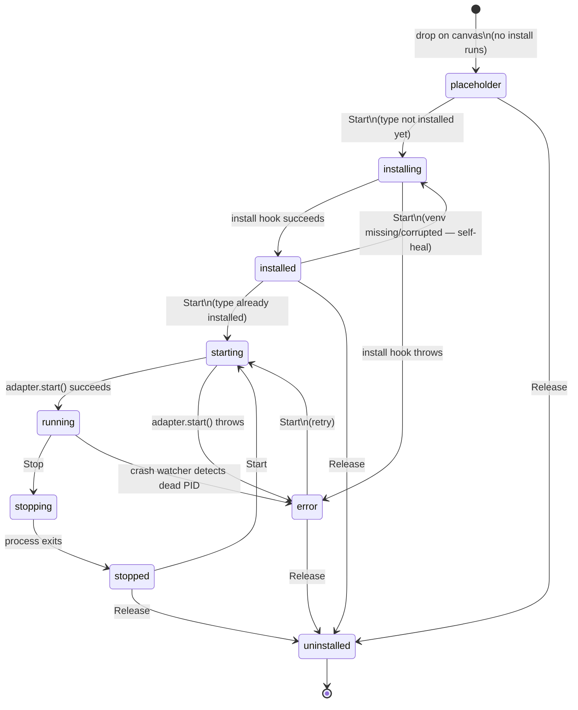
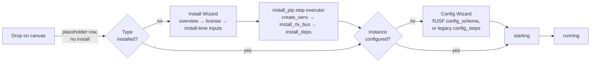
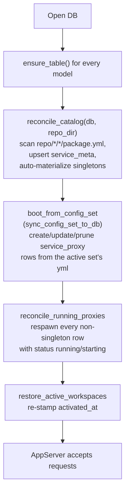

# Service Lifecycle

How a botgear service goes from source on disk to a running instance an
operator can talk to — and everything in between (install, configure,
start, stop, release, restart). This is a synthesis doc: the canonical
detail lives in [`AGENTS.md`](../AGENTS.md) ("Runtime lifecycle",
"Config sets", "Boot sequence") and [`repo/README.md`](../repo/README.md)
("Lifecycle states"); this page exists because those two facts — a
**type** lifecycle and an **instance** lifecycle — are easy to conflate
and are almost never explained side by side.


## 1. Two lifecycles, not one

| | Type lifecycle | Instance lifecycle |
|---|---|---|
| Unit | `type@version` (e.g. `tasmota@1.0.0`) | one `service_proxy` row (e.g. `sonoff-cord`) |
| Question it answers | "Are this type's dependencies installed?" | "Is this particular instance running?" |
| States | `ABSENT → LOADED → INSTALLED` (+`FAILED`) | `placeholder → installing → installed → starting → running` (+`stopping`, `stopped`, `error`, `uninstalled`) |
| Shared by | every instance of the type | — |
| Authoritative field | `service_meta.install_phase` | `service_proxy.status` |
| Lives at | `repo/<type>/<version>/.venv` (+ `.install-state.json`) | `service_proxy` DB row (ephemera) + `data/config_sets/<set>/<proxy_id>.yml` (config) |

A type can be INSTALLED while every instance of it is `stopped`. A type
can be un-INSTALLED (venv deleted) out from under a `running` instance —
recovering from that is the self-heal path in §2 and §3. They're
independent axes.


## 2. Type-level: `ABSENT → LOADED → INSTALLED`

```mermaid
stateDiagram-v2
    [*] --> ABSENT
    ABSENT --> LOADED: registry archive extracted,\nor dev checkout on boot
    LOADED --> INSTALLED: install hook runs\n(pip: builds .venv)
    INSTALLED --> LOADED: uninstall_type\n(rm -rf .venv + marker)
    LOADED --> ABSENT: Remove\n(deletes source; disabled\nfor bundled:true)
    LOADED --> FAILED: install hook throws
    FAILED --> LOADED: retry
```



- **ABSENT** — no `repo/<type>/<version>/` dir; only a reachable
  registry's `catalog.yml` knows it exists.
- **LOADED** — dir exists, `package.yml` parses, visible in the Catalog
  and `/v1/service-meta-list`, but not ready to Start. A dev checkout has
  everything LOADED at boot; a fresh registry `tar -xzf` also lands here.
- **INSTALLED** — the install hook has run (pip services get a built
  `.venv` + `.install-state.json` marker). Ready to Start. Builtins
  (`language: builtin`, no `dependency_manager`) are always INSTALLED —
  there's nothing to install.

`install_phase` (`loaded | installing | installed | failed`) is
authoritative; `service_meta.installed: bool` is a derived mirror kept
only for back-compat.

**Uninstall vs Remove are different actions**, easy to confuse because
both look like "undo install" from the UI:
- **Uninstall** (`uninstall_type`, `runtime/lifecycle.py:_handle_uninstall_type`)
  drops INSTALLED → LOADED: `rm -rf`s the venv + marker, keeps source +
  catalog entry. Refuses if any instance of the type is active
  (installing/starting/running/stopping) — resets non-running instances
  to `placeholder` first. Cheap to reinstall.
- **Remove** drops LOADED → ABSENT: deletes the source directory itself.
  Disabled in the UI for `bundled: true` services (the next bundle
  extraction would just bring them back).

A missing/deleted/corrupted venv self-repairs: `_handle_start`'s
lazy-install gate fires whenever a pip type isn't `installed`, not just
on a fresh `placeholder` — so install ↔ uninstall cycles are fully
repeatable with no stale state.


## 3. Instance-level: `service_proxy.status`

### Service (proxy) names

A proxy name is the row id, the `<name>.yml` filename, a bus topic segment
(`/<type>/<name>/control`) and a URL segment (`/v1/service-proxy/<name>`).
`install` therefore requires it to be **lowercase letters, digits, `-` and
`_`, starting with a letter, at most 63 characters** (`sabertooth-1`,
`network_scanner-1`), and unique. Anything else fails with
`invalid service name …` (`lifecycle.validate_proxy_name`; the Composer's
install dialogs mirror the rule inline). The check runs on **install only**:
yml files already on disk with older names (e.g. `workE`) still load at boot.
Avoid `/`, `\`, `+`, `#`, `@`, spaces and `.` in particular — they collide
with paths, bus wildcards, the `@<runtime-id>` federation suffix and URLs.



Status meanings (`runtime/lifecycle.py`):

| Status | Meaning |
|---|---|
| `placeholder` | Dropped on the canvas, nothing installed yet. Grey dot, Play button. Startable. |
| `installing` | Type's install hook is running (or re-running, self-heal case). |
| `installed` | Created but not started — `desired_state` (from the yml) is the sole spawn driver; a member with no `desired_state` sits here. Startable. |
| `starting` | `adapter.start()` in flight (in-process call or subprocess spawn). |
| `running` | Live. `pid`/`host`/`port` populated. |
| `stopping` | Stop requested, process not yet confirmed exited. |
| `stopped` | Clean stop. Startable. |
| `error` | Install or start threw, or the crash watcher found a dead PID where the row claimed `running`/`starting`. Startable (retry). `error` field carries the message. |
| `uninstalled` | Terminal — row about to be deleted by Release. Never persists; see §5. |

`_handle_start` accepts Start only from `{placeholder, installed,
stopped, error}` (`lifecycle.py:419`) — `error` is deliberately
startable so "fix the config and try again" doesn't require a separate
reset action. `_handle_stop` treats `{stopped, error, uninstalled}` as a
no-op (better UX than refusing) and self-corrects a stale `running`/
`starting` row whose PID is actually dead, without requiring a kill.


## 4. The gated Start flow

Three previously-conflated concerns — **place** a block, **install** a
type's deps (one-time, shared), **configure + start** an instance — are
separate steps, driven by per-type `package.yml` metadata
(`wizard_steps`/`wizard_schema`/`install_steps`/`config_steps`/
`config_schema`/`ui_schema`/`license`):



- **Install Wizard** (`InstallWizard.tsx`, one-time per type): license
  acceptance gate, then install-time inputs via the hand-rolled
  `FieldInput` renderer (not yet RJSF — no schema-introspection producer
  exists for `wizard_schema` yet). `install_pip` emits structured
  `{step_id, label, index, total, status, detail?, stream?, error_code?}`
  events, rendered with Retry by `InstallProgress.tsx`.
- **Config Wizard** (`ConfigWizard.tsx`, per-instance): prefers
  `config_schema` rendered via RJSF (`SchemaForm.tsx`) when present,
  falls back to legacy `config_steps`. Subprocess types self-report
  their schema via `schema_introspect.subprocess_config_schema()` — a
  one-shot script run through the type's own venv python, importing
  `config_class.model_json_schema()`. Runs at boot and after a type's
  first install, so no restart is needed. `SecretStr` fields render as
  password widgets automatically. Seeds from `GET
  /v1/service-proxy/{id}/config` (→ `lifecycle.proxy_config()`, the same
  yml-backed accessor as everywhere else) — **not** a blank form — so a
  freshly re-created instance whose name matches a preserved yml (§5)
  pops up pre-filled with the old values: the wizard still gates on the
  new row's `configured` flag, but functions as a review/confirm pass
  rather than data entry from scratch.

Not yet done (non-blocking): npm/mvn/docker dependency managers (pip is
the only implemented one); per-(type,user) license persistence (gated by
install state only today).


## 5. Release vs Stop vs "Park" — and swap-by-name

Two different-looking "make it go away" actions, worth having in one
table because confusing them mid-debug session is easy (the
`office-cord`/`sonoff-office-light` removals during the `brain`
device-control work were exactly this):

| Action | DB row | `<proxy_id>.yml` | `runtime.yml` registry | Reversible how |
|---|---|---|---|---|
| **Stop** (`stop_service`) | `running`→`stopped` | untouched | untouched | Start |
| **Release** (`release_service` → `_handle_uninstall`) | deleted immediately | **preserved** | name removed | re-add the name (or drop a fresh instance under it) → picks the preserved yml straight back up |

Release and "Park" (manually removing a name from the registry without
going through Release at all) are now the same operation — Release just
does it immediately via an explicit action instead of waiting for the
next boot's prune pass. **Config is never deleted by removing a service
from the canvas.** This was a deliberate change: Release used to also
delete the yml ("durable uninstall"), which destroyed real operator
work (secrets, tuned values) every time a service was removed even just
to troubleshoot. There is currently no separate "purge config" action —
a genuinely-unwanted yml is a manual file delete in the config set
directory; `ConfigSetSwitcher.tsx` lists candidates but has no delete
affordance for one today.

`boot.py::sync_config_set_to_db`'s prune logic is what makes this work:
it treats the registry as authoritative for *membership only* — any
non-singleton row whose id isn't in `registry` gets its DB row deleted,
full stop, regardless of how it got un-registered. The yml is never
touched by that pass either. Singletons (`runtime`, `security`) can't
be Stopped or Released — refused at the handler.

**Swap-by-name.** Because `proxy_config_dict()` (§6) reads
`<proxy_id>.yml` purely by path — it has no idea whether "the same"
logical instance is behind it — releasing an instance and later
creating a *different-typed* one under the same name transparently
picks up the old yml's config. This is intentional, not a gap to guard
against: it's how an operator maintains several fully-configured
alternate implementations of one capability (e.g. `speech-local.yml`,
`speech-polly.yml`, `speech-azure.yml`, each already validated) and
switches which is live by renaming one onto the registered slot name
(e.g. `speech.yml`) — the same mechanism as the plain candidate-swap in
§6, just exercised deliberately across incompatible types sharing a
capability interface rather than across versions of one type.


### Renaming a service — `rename_service`

A name is the row id, the `<name>.yml` file, the registry entry, the
workspace layout key, a bus topic segment, and (as plain strings) a
reference in other services' configs — there is no indirection, so it
can't be changed by editing one place. `rename_service` does it in one
request (`runtime/rename_service.py`):

```json
POST /v1/service-request
{ "action": "rename", "service_proxy_id": "network_scanner-1",
  "new_name": "network_scanner", "dry_run": true }
```

Run it with `dry_run: true` first — the result line lists exactly what would
change. Options: `rewrite_references: false` reports references without
touching them.

| Step | What happens |
|---|---|
| Guards | Refused while the service is running/starting/stopping (**stop it first**), for singletons, for an invalid name (see above), or if the target name already has a row, a yml (including a parked/released one) or a registry entry. |
| yml + registry | `<old>.yml` → `<new>.yml`; the registry entry is swapped **in place**, so start order is kept. If the registry write fails the yml move is rolled back. |
| References in other ymls | Rewritten only in unambiguous shapes: a topic `/<type>/<old>/…` (any `@peer` suffix kept), a `<type>/<old>` ref, or a bare name under an id-ish key (`*_id`, `*_ids`, `id`, `proxy_id`, `target`, …). Anything else that merely mentions the name — a `label`, prose, a mapping *key* — is **listed for review, not changed**. Files are rewritten in place with comments/order/quoting kept; only files that change are written. |
| Workspaces | Members, node positions, view types and edges are re-keyed, so the canvas layout survives (unlike Release, which strips them). |
| DB row / bus | Row re-keyed. The old name gets a retained lifecycle `uninstalled` (with `renamed_to`) and its other retained topics (`meta`, `state`, `config_state`…) are dropped, so nothing rediscovers a ghost. The **brain** evicts the old name's tools on that event. |
| Live dependents | A *running* service whose config was rewritten gets a live config reload. Whether it re-subscribes is per-service — restart it if it holds onto old topics. |
| Not edited | Brain workflow files (`allowed_tools.yaml`, `prompt.md`) that mention the old name are **reported only** — they're operator prose and the bundled ones are read-only. Workflows that use wildcards (`/video/*/control`) need nothing. |

The same brain eviction now also runs on **Release**: a released
service's tools no longer linger in `list_tools` and no longer pass the
safety gate's "live service" check.


## 6. Config sets — the persistence layer underneath both lifecycles

Per-instance config lives on disk under `data/config_sets/<set-name>/`,
**not** in the DB — the DB (`service_proxy` rows) holds only ephemera
(`status`, `pid`, `started_at`, `error`). One yml per proxy instance,
named `<proxy_id>.yml`, `type: <type>@<version>` at the top plus the
Pydantic config dump.

- **`<set>/runtime.yml`** holds only `registry` — a plain, ordered list
  of proxy_ids (`RuntimeYml.registry`). `runtime` and `security` are
  auto-prepended, can't be reordered. The old `start_order:` key still
  parses but is a deprecated read-only alias of `registry` —
  `RuntimeYml.start_order` just returns `self.registry`.
- **`desired_state`** in each instance yml (`running` / `stopped` /
  absent) is the *sole* driver of a freshly-synced row's initial status —
  registry membership no longer implies running.
- **Candidates**: any `.yml` in the active set NOT listed in the
  registry is a parked/swappable candidate — pure presence, no marker
  file. The UI lists it as a swappable implementation; swapping is two
  `mv`s (git diff shows it as a file rename).
- **Secrets**: `Encrypt--<plaintext>` round-trips through the `security`
  singleton to `Encrypted--<fernet-token>` on next save. Config classes
  stay plaintext-typed (`SecretStr`); the persistence layer owns
  encryption both ways, not the service code.
- **Capability interlock** is enforced at boot from these same yml
  files: a proxy's bound type must satisfy its `requires: [...]` against
  already-started proxies' `implements: [...]` — this is what makes
  candidate-swap-by-rename safe (boot refuses a swap that breaks a
  dependency).
- Switching **active sets** requires a restart — no hot-swap, no
  filesystem watcher (`BOTGEAR_CONFIG_SET` env var).

See `runtime/config_sets.py` (loader/writer) and
`services/config_set_service.py` (set CRUD).


## 7. Boot sequence



1. Open the database (sqlite by default; TinyDB if
   `BOTGEAR_DATABASE_TYPE=lowdb`).
2. `ensure_table(...)` for every model.
3. `reconcile_catalog(db, repo_dir)` — scans `repo/*/*/package.yml`,
   inserts/upserts `service_meta` rows, auto-materializes singleton
   `service_proxy` rows (`runtime`, `security`).
4. Seed the `config/default` row if missing.
5. `ensure_runtime_workspace(db)` — materialize the singleton runtime
   workspace.
6. `boot_from_config_set` syncs the active config set's yml files into
   `service_proxy` rows (see §6), pruning anything not in the registry.
7. `reconcile_running_proxies(db)` — for every non-singleton proxy with
   status `running`/`starting`, reset to `stopped` then fire
   `start_service` via the adapter. This is what revives services that
   died with the previous backend process.
8. `restore_active_workspaces(db)` — re-stamp `activated_at`/status on
   workspaces that were active before shutdown.

After this, `AppServer` runs and accepts requests.


## 8. Restart

`runtime/system.py`: `record_start_command()` serializes the exact
launch command (`sys.orig_argv`) to `last_start_command.json` on
startup; `restart()` does `os.execv` with it — no supervisor required.
`graceful_restart()` wraps it: `set_draining(True)` →
`drain_services()` (stops every non-singleton service, no orphaned
subprocesses) → `restart()`. `is_draining()` is checked at the top of
`_handle_install`/`_handle_start` so nothing new starts into a
shutting-down runtime. On the next boot, the config set's `running`
rows go through §7 step 7 exactly as after a crash. `os.execv` still
drops in-flight HTTP requests — for supervised prod, run under systemd
`Restart=always`.


## 9. Adjacent concepts, quick disambiguation

Easy to conflate with "lifecycle" but answering a different question:

- **Config set** (§6) — the durable, file-defined inventory. "The
  installed system." Switching = restart.
- **Runtime canvas** (`kind: 'runtime'` workspace) — the live view of
  every running service. `service_proxy_ids` is *computed* at read
  time from status ∈ {running, starting}; layout/edges persist.
- **Workspace** (`kind: 'user'`) — a saved, named *view* over the same
  shared pool of running services (which subset to show + layout), not
  a separate inventory and not a batch start/stop lever. Activating one
  runs `start_service` for each member; deactivating stops them, except
  singletons and instances claimed by another active workspace
  (reference-counted).


## Where to look

| Topic | File |
|---|---|
| Instance state transitions | `src/botgear/runtime/lifecycle.py` (`_handle_start`, `_handle_stop`, `_handle_uninstall`, `_handle_uninstall_type`) |
| Type registry / catalog sync | `src/botgear/runtime/registry.py`, `repo/README.md` ("Lifecycle states") |
| Config-set loader + boot sync | `src/botgear/runtime/config_sets.py`, `src/botgear/runtime/boot.py` |
| Boot orchestration | `src/botgear/event_handlers.py` (`on_startup`) |
| Install/config wizard UI | `apps/botgear_ui/src/components/{InstallWizard,ConfigWizard,InstallProgress,SchemaForm}.tsx` |
| Restart | `src/botgear/runtime/system.py` |
| Fuller narrative + source-of-truth for anything above that drifts | `AGENTS.md` ("Runtime lifecycle", "Config sets", "Boot sequence") |
