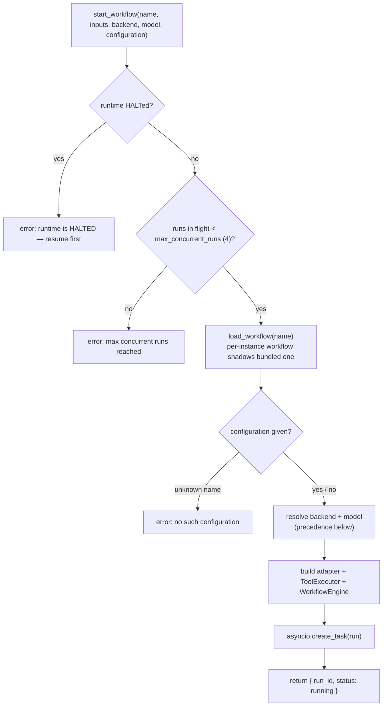
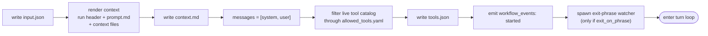
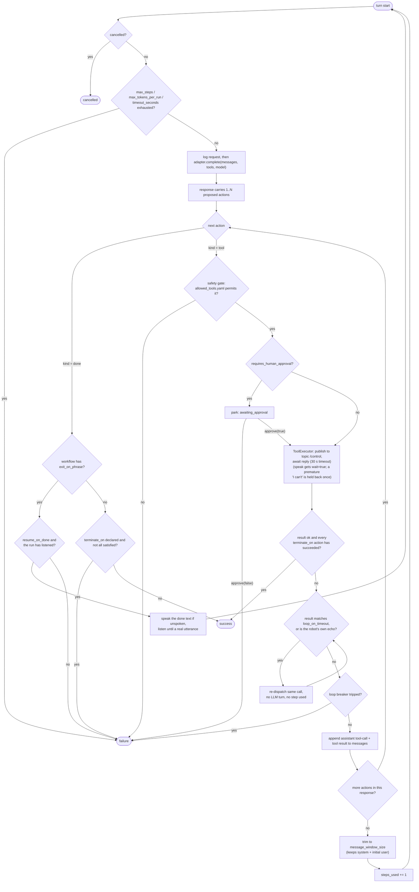
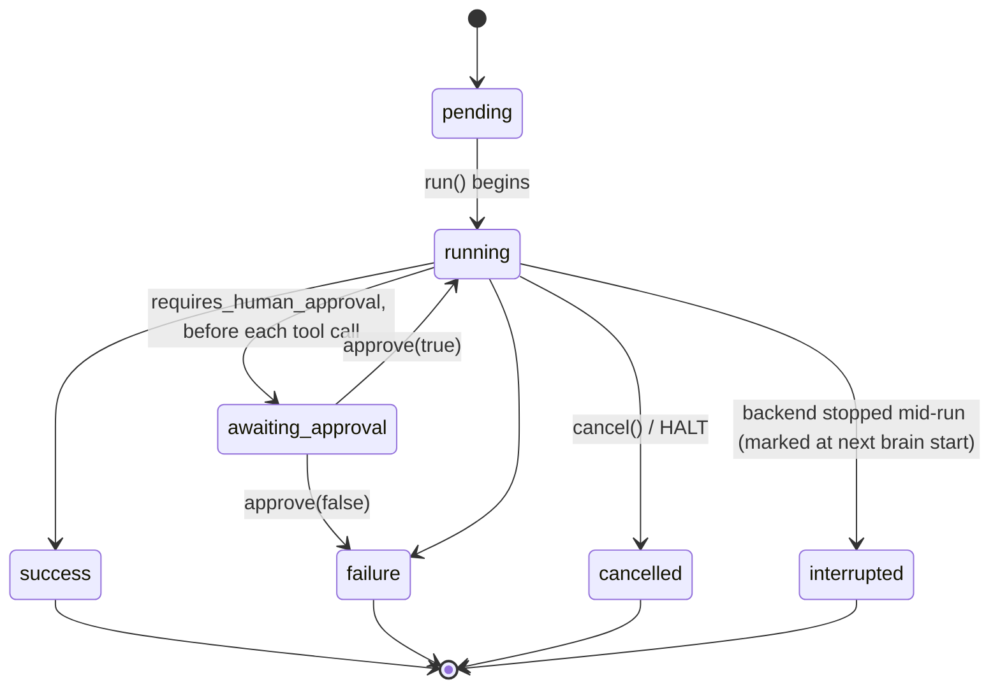

# brain — workflow brain service

In-process botgear service that runs folder-defined **workflows** against
pluggable **model adapters** (Ollama / Anthropic / OpenAI / mock). A workflow
is a directory; the engine loops *LLM → safety gate → bus tool call → result
back to the LLM* until the workflow reaches a terminal state.

```
type:      brain
version:   1.0.0
language:  builtin (in-process — no install needed)
bundled:   true
```

Companion docs:

- [`../../../docs/AGENT_ARCHITECTURE.md`](../../../docs/AGENT_ARCHITECTURE.md) —
  the big picture: brain, the agent service, the MCP gateway and the shared
  agent surface, and how they fit together. Start here.
- [`README_ENGINE.md`](README_ENGINE.md) — `WorkflowEngine` internals (message
  threading, concurrency, guard table). Read it when working on the engine.
- [`TESTING_RESULTS.md`](TESTING_RESULTS.md) — per-model validation matrix.
- [`TODO.md`](TODO.md) — open ideation items.
- [`../../../docs/AGENT_ROADMAP.md`](../../../docs/AGENT_ROADMAP.md) — where
  brain fits among AI agents driving botgear (MCP gateway, agent_harness,
  pluggable minds). Read it before restructuring brain.

**Contents**
[How a run is processed](#how-a-run-is-processed) ·
[How a run ends](#how-a-run-ends) ·
[What the LLM sees](#what-the-llm-sees) ·
[Workflow layout](#workflow-layout) ·
[workflow.yaml fields](#workflowyaml-fields) ·
[Named run configurations](#named-run-configurations) ·
[Bus actions](#bus-actions) ·
[Model adapters](#model-adapters) ·
[Run artefacts](#run-artefacts) ·
[Workspace file browser](#workspace-file-browser-ui) ·
[Authoring workflows](#authoring-new-workflows)


## How a run is processed

A run has three phases: **start** (resolve what to run and how), **loop**
(the engine drives the LLM), and **finish** (record the outcome).

### 1. Start — `start_workflow`

`start_workflow` returns a `run_id` immediately; the run continues as a
background `asyncio` task. Nothing below blocks the caller.



Precedence (highest first):

```
backend:  call arg  >  configuration  >  preferred_backend  >  BrainConfig.default_model
model:    call arg  >  configuration  >  preferred_model    >  adapter default
```

`restart_on_end=True` marks the run *supervised* (keepalive): when it ends, an
identical run is launched, **except** after an operator `cancel`, an exit
phrase ("goodbye"), or while the runtime is HALTed. Capped at 10 restarts per
300 s per workflow so an instantly-failing workflow can't restart-loop.
Capabilities a run loaded via `describe_capability` carry over to the next
run of the same workflow.

### 2. Loop — `WorkflowEngine.run()`

Before the first turn the engine sets up everything that stays constant for
the run:



Then it repeats one **turn** per LLM round-trip:



Things the diagram compresses:

- **A "step" is an LLM round-trip, not a tool call.** A model may return
  several actions in one response (e.g. `power_set` + `speak`); they run in
  order under the same step. Any terminal outcome ends the run at once and
  the remaining actions in that response are never reached.
- **Guards run *before* the LLM call**, so an exhausted run stops without
  spending another token. `max_tokens_per_run` sums `input + output` usage
  and is a no-op for adapters that report none.
- **A tool returning `error` or `timeout` does not end the run.** The
  failure text (`ERROR …` / `TIMEOUT …`) is threaded back so the model can
  react. Only `terminate_on` counts *successful* calls.
- **`loop_on_timeout` is invisible to the LLM.** It only ever sees the first
  non-matching result. Each re-dispatch still writes its own `tool_calls.jsonl`
  record. Cancel and the wall-clock timeout still fire from inside it.
- **Exit phrase runs beside the loop.** The watcher subscribes to
  `exit_on_phrase.listen_topic` and, on a match, cancels the run task; the
  engine converts that cancel into **success**.
- **Conversation reflexes are engine code, not prompt.** `speak_wait`
  (turn-taking), `echo_filter` (drop the robot's own voice), `resume_on_done`
  (a mid-conversation `done` speaks its text and listens again),
  `loop_breaker` (end a run that talks to itself) and the refusal hold-back
  (an "I can't" while a listed capability is still unloaded goes back to the
  model instead of the operator). See [Conversation reflexes](#workflowyaml-fields).
- **Every phase change is published.** The run's `phase` (`starting`,
  `thinking`, `listening`, `speaking`, `calling`), `last_heard`,
  `silent_listens` and counts ride on `/brain/<id>/state` → the brain panel.
- **HALT** (`/runtime/halt`, see `AGENTS.md`) cancels every run at once and
  stops their speech.

### 3. Finish

Every terminal transition writes `result.md`, stamps `ended_at`, rewrites
`summary.json`, and emits `ended` on `/brain/<id>/workflow_events` (with
status, duration and tool-call count). The run then drops out of the
in-flight set, freeing a concurrency slot.

Status lifecycle:




## How a run ends

Every run ends in exactly one terminal status.

| # | Status | Trigger |
|---|---|---|
| 1 | **success** | Model emits `done` — unless `terminate_on` is unmet or `exit_on_phrase` is set (both are failures, below). |
| 2 | **success** | `terminate_on` satisfied: after any successful tool call, every listed action has now succeeded. Engine-driven, no LLM needed. |
| 3 | **success** | `exit_on_phrase` matched an operator message on `listen_topic`. Latency is bus round-trip, not inference. |
| 4 | failure | `max_steps` exhausted. |
| 5 | failure | `max_tokens_per_run` exceeded. |
| 6 | failure | `timeout_seconds` exceeded (checked each turn and inside the `loop_on_timeout` inner loop). |
| 7 | failure | Unsafe tool call — the safety gate rejected the proposed action. (Disallowed tools are also hidden from the model, so this is a second line of defence.) |
| 8 | failure | Operator denied approval. |
| 9 | failure | Model emitted `done` before every `terminate_on` action had succeeded — guards against hallucinated completion. |
| 10 | failure | Model emitted `done` on an `exit_on_phrase` workflow **before it ever listened** (or with `resume_on_done: false`). Those end only on the phrase; a `done` almost always means the model narrated tool calls as text. The message names the likely cause. After a first `listen`, `resume_on_done` turns a `done` into "speak it, listen again" instead. |
| 10b | failure | `loop_breaker` tripped: too many `speak`s without hearing the operator, or too many self-echoes dropped. Reason starts `loop breaker:`; the run's speech is stopped. |
| 11 | failure | Unexpected exception → `engine error: <Type>: <msg>` (also written to `errors.log`). |
| 12 | **cancelled** | `cancel()` or a runtime-wide HALT. Sets the cooperative flag *and* cancels the task, so an in-flight slow inference aborts immediately. A HALT's reason (`halted by voice:ear: heard 'stop'`) is kept as `failure_reason`. |
| 13 | **interrupted** | The backend stopped while the run was active. Written into `summary.json` by the next brain start (the run couldn't record its own end). |

Any run that ends **without success** (cancel, HALT, exit phrase, failure)
sends `stop` to every speech service it spoke on, so queued replies don't keep
playing after the run is gone.

`result.md` holds `success.md` / `failure.md` from the workflow folder (or the
summary/reason if that file is absent); on failure the reason is appended.


## What the LLM sees

Every turn sends three components:

| Component | Source | Sent as |
|---|---|---|
| **System prompt** | Short fixed text built from the workflow: identity + `description` as goal, "act only through the provided tools; refusing with an explanation is valid", "emit a terminal `done` with a one-line summary when complete". | `role: system` |
| **User context** | Run header (run id, workflow, backend, model) + an **Environment** section (local date/time at start, runtime version/host/battery/services from retained `/runtime/...` topics, git commit) + `prompt.md` with `{key}` input substitution + each file listed in `workflow.context` under a `--- <path> ---` divider + (lazy workflows) the **capability index** of not-yet-loaded capabilities. | `role: user` |
| **Tools** | The live tool catalog (from each peer's retained `/{type}/{id}/meta`; entries are dropped when a service is released or renamed away) filtered through `allowed_tools.yaml`; for `lazy_tools` workflows over `lazy_tools_threshold`, only always-loaded + discovered capabilities. | Provider-native tool array |

- The `messages` array **grows** every turn (assistant tool call + tool result
  appended). The `tools` array is constant, except in lazy workflows, where it
  grows as `describe_capability` loads capabilities (the index in the context
  message is rewritten to match; `describe_capability` results are filtered
  through the safety gate, so blocked actions' schemas never reach the model).
- With `stamp_time`, every real heard `listen` result carries
  `[now: <local time>]`, since the Environment's start time goes stale.
- Only `(topic, action)` pairs the workflow grants are ever shown, so a buggy
  model can't propose a tool it wasn't offered.
- **Memory is opt-in.** A memory file (`memory/observations.md`,
  `known_objects.md`, `task_history.md`) reaches the model only if the
  workflow lists it under `context:`. `write_memory` is the only writer.
- Input substitution is Python `str.format`: `{name}` is replaced, `{{` /
  `}}` give literal braces, and an unknown key fails the run at start with a
  clear error.
- Adapters translate the internal `ChatMessage` + `ToolDescriptor` types to
  the provider's wire format (Ollama/OpenAI `{type:"function", function:{…}}`;
  Anthropic `{name, input_schema}`).


## Workflow layout

Bundled (read-only, "example") workflows live in `workflows/` next to this
README. Per-instance workflows live under the runtime data dir and
**shadow** a bundled one of the same name:

```
<data_dir>/brain/<proxy-id>/
  workflows/   per-instance — operator-owned, shadows bundled on name clash
  memory/      markdown memory files
  runs/        one folder per workflow run
```

Each workflow is a folder. **The directory name is the workflow's identity**
— the single source of truth for run dirs, log filenames and the Run
button's lookup. Any `name:` in `workflow.yaml` is ignored (storing it in two
places desyncs on duplicate/rename).

```
workflows/observe_room/
  workflow.yaml       config — see "workflow.yaml fields"
  prompt.md           user-visible task description
  allowed_tools.yaml  topic-pattern allow/deny rules
  success.md          written to result.md on success
  failure.md          written to result.md on failure
```


## workflow.yaml fields

Every key the engine reads. **None are documentation-only** — each is
enforced at run time by the context loader, the engine's guards, or the
safety gate. Keep this table in sync with
[`brain/schemas.py::Workflow`](brain/schemas.py),
[`context_loader.py`](brain/context_loader.py) and the engine's guards.

**Identity & model selection**

| Field | Type | Default | Effect |
|---|---|---|---|
| `description` | str | `""` | UI card text and `list_workflows`; also the goal line of the system prompt. |
| `preferred_backend` | str | `mock` | Adapter used unless overridden at `start_workflow`. |
| `preferred_model` | str \| null | `null` | Model id passed to `adapter.complete(model=…)` each call. Null → the adapter's own default. |
| `configurations` | list of `{name, backend, model?, description?}` | `[]` | Saved alternates to `preferred_*`, shown as the toolbar dropdown. See [Named run configurations](#named-run-configurations). |
| `model` *(deprecated)* | str | — | Alias for `preferred_backend`. |

**Inputs & context**

| Field | Type | Default | Effect |
|---|---|---|---|
| `inputs` | object | `{}` | Drives the UI input form; validated in `start_workflow`. |
| `context` | list of paths | `[]` | Files read (relative to the workspace) and appended to the user prompt at run start. Missing/empty files are skipped. |
| `steps` | list of step objects | one default | Engine reads `steps[0].{prompt,on_success,on_failure}` paths. Multi-step graphs are reserved. |

**Guards (failure when tripped)**

| Field | Type | Default | Effect |
|---|---|---|---|
| `max_steps` | int | `8` | LLM round-trips allowed ([`check_max_steps`](brain/safety_gate.py)). |
| `timeout_seconds` | int | `120` | Wall-clock deadline for the whole run. |
| `max_tokens_per_run` | int \| null | `null` | Sum of `input + output` tokens ([`check_max_tokens`](brain/safety_gate.py)); skipped when null. |
| `requires_human_approval` | bool | `false` | Parks the run as `awaiting_approval` before **every** tool call until `approve` / `cancel`. |

**Tool disclosure** (for big live catalogs)

| Field | Type | Default | Effect |
|---|---|---|---|
| `lazy_tools` | bool | `false` | Show full schemas only for `always_loaded_prefixes` + `brain` + capabilities the model loaded with `describe_capability`; everything else appears as a one-line capability index. |
| `always_loaded_prefixes` | list of str | `[]` | Capability prefixes (`stt`, `speech`, …) always fully loaded — the conversation I/O the loop needs every turn. |
| `lazy_tools_threshold` | int | `120` | Lazy disclosure only applies when the allowed catalog has more actions than this (~90 actions ≈ 6k tokens of schema). `0` = always lazy. Below it, everything is loaded and there's nothing to "discover". |

**Completion control**

| Field | Type | Default | Effect |
|---|---|---|---|
| `terminate_on` | list of `{action: str}` | `[]` | Success the moment every listed action has succeeded. Also makes a premature model `done` a failure. |
| `exit_on_phrase` | `{matches, case_insensitive, whole_message, listen_topic}` \| null | `null` | Watcher on `listen_topic`; a match cancels the run and the engine turns that into **success**. `listen_topic` is a topic/wildcard **or a list** (needed when several messaging service types may run). `case_insensitive` defaults true; `whole_message` defaults true (the utterance must equal a phrase, so "stop the servo" doesn't match "stop"). A model `done` is a failure on these workflows. |

**Long-running conversations**

| Field | Type | Default | Effect |
|---|---|---|---|
| `loop_on_timeout` | `{tool, field, value}` \| null | `null` | When the named tool returns `result.value[field] == value`, re-dispatch the same call with no LLM turn and no step used. Canonical case: `chat.listen` returning `{timeout: true}`. |
| `message_window_size` | int \| null | `null` | After each turn, keep only the last N messages plus the head (system + initial user context); leading orphan `tool` messages are dropped. Null → unbounded (a long run eventually hits the model's context cap). |

Together `exit_on_phrase` + `loop_on_timeout` + `message_window_size` make
hours-long conversational workflows safe (see
[`conversation_servo`](workflows/conversation_servo/workflow.yaml)).

**Conversation reflexes** (engine behaviour, on by default; each can be
turned off per workflow)

| Field | Type | Default | Effect |
|---|---|---|---|
| `speak_wait` | bool | `true` | Adds `wait: true` to every `speak` on `/speech/*/control` (unless the call sets `wait`), so the next `listen` can't start while the reply is still playing. |
| `echo_filter` | `false` \| `{enabled, window_seconds, min_words, threshold}` | on, `15`, `3`, `0.75` | A `listen` result whose words mostly appear, in order, in something spoken in the last `window_seconds` is dropped and re-listened. ≥ `min_words` only; the same text heard twice in a row passes (the operator repeating it). Backstop to the STT's own echo gate. |
| `resume_on_done` | bool | `true` | `exit_on_phrase` workflows only: a model `done` after the first `listen` speaks its text (if not just spoken; small models put the reply there) and listens again, in the same run. |
| `stamp_time` | bool | `true` | Append `[now: <local time>]` to each real heard `listen` result. |
| `loop_breaker` | `false` \| `{enabled, max_consecutive_speaks, max_echo_drops, echo_drop_window_seconds}` | on, `4`, `3`, `60` | End the run (failure, speech stopped) after N `speak`s without hearing the operator, or N echoes dropped within the window. `0` disables one check. |

The refusal hold-back has no field: in a lazy workflow, a `speak` that says
the robot can't do something while a listed capability is still unloaded is
returned to the model once ("NOT SPOKEN — check <capabilities> first").

**`allowed_tools.yaml`** (`allowed:` / `blocked:` lists of `{topic, actions}`
rules, plus `default_policy`) is consumed by the safety gate before every tool
call: `blocked` always wins, `*` matches one path segment, `@**` opts into
federation. `default_policy: deny` (default) allows only what `allowed`
lists; `default_policy: allow` allows anything not blocked **and** always
inherits the shared hardware excludes in
[`botgear/agent_surface/excludes.py`](../../../src/botgear/agent_surface/excludes.py)
(movement, arm, system, video, …), which a workflow can't opt out of.


## Named run configurations

`configurations` is a list of saved `(backend, model)` combos in
`workflow.yaml`. Each `name` becomes a label in the brain panel's toolbar
dropdown — pick one to switch backend + model without editing yaml.
`preferred_backend` / `preferred_model` remain the canonical defaults.

```yaml
configurations:
  - name: fast
    backend: ollama
    model: llama3.2:3b
    description: "Smallest validated model — TESTING_RESULTS.md."
  - name: production
    backend: anthropic
    model: claude-opus-4-8
```

**UI:** the dropdown lists each saved entry plus `(preferred)` (no override)
and `(custom)` (shown when backend/model match no entry). Editing backend or
model directly enters `(custom)` and reveals a **save** button (prompts for a
name → `save_run_configuration`; forks a bundled workflow into the workspace
first if needed).

Precedence is the chain shown under [Start](#1-start--start_workflow). Configs
persist via a `ruamel.yaml` round-trip, so comments and key order in
`workflow.yaml` survive saves.


## Bus actions

All are `@service_method`s on `/brain/<id>/control`, callable from any bus
client (`rlx call /brain/<id>/control <action> ...`).

**Runs**
```
list_workflows()                                     → workflow cards
list_tools()                                         → live tool catalog
describe_capability(capability)                      → full actions for one capability
                                                       (filtered by the caller's gate)
start_workflow(name, inputs={}, backend=None, model=None,
               configuration=None, restart_on_end=False)
                                                     → {run_id, status}
cancel(run_id, reason="")                            → {cancelled: bool}
approve(run_id, decision=True)                       → {approved: bool}
get_run(run_id)                                      → RunRecord (in-flight runs only)
get_run_log(run_id, limit=100)                       → {summary, steps, tool_calls} from the
                                                       run dir (any run; backfills the panel)
clear_runs()                                         → delete finished run folders
write_memory(kind, content)                          → {written: true}
```

Not an action but obeyed by the service: a runtime-wide HALT
(`/runtime/halt`) cancels every run and makes `start_workflow` refuse until
`/runtime/resume`.

**State** (`/brain/<id>/state`, retained): `active_runs[]` with `status`,
`phase`, `phase_detail`, `phase_since`, `last_heard`, `last_heard_at`,
`silent_listens`, `steps_used`, `tool_calls`, `started_at`; republished on
every phase change.

**Run configurations** (per-workflow saved `(backend, model)` combos)
```
list_run_configurations(workflow=None)
save_run_configuration(workflow, name, backend, model=None, description="")
set_default_configuration(workflow, name)   # promote to preferred_*
delete_run_configuration(workflow, name)
save_workflow_preferences(...)              # write preferred_backend/model etc.
```

**Backends** (adapter credentials / model lists)
```
get_backends()                  set_backend(name, ...)
set_active_backend(name)        clear_backend(name)
list_backend_models(backend)    test_backend(name)
```


## Model adapters

| name | endpoint | required config |
|---|---|---|
| `mock` | (in-memory) | none |
| `ollama` | `{OLLAMA_BASE_URL}/api/chat` | `ollama_base_url` (default `http://localhost:11434`) |
| `anthropic` | `https://api.anthropic.com/v1/messages` | `anthropic_api_key` (env `BRAIN_ANTHROPIC_API_KEY`) |
| `openai` | `https://api.openai.com/v1/chat/completions` | `openai_api_key` (env `BRAIN_OPENAI_API_KEY`) |
| `claude_agent` | a Claude Agent SDK session (Claude Code CLI) | the backend user's Claude Code login; `claude_agent_model` (default `haiku`), `claude_agent_max_usd_per_run` (default 1.0), optional `claude_agent_cli` |

Select per workflow via `preferred_backend`, globally via the instance's
`default_model`, or per call via `start_workflow(name, backend="…")`.
The four step adapters use **httpx only** — no vendor SDK — so AI
dependencies don't bloat the core rlx bundle. Each is a small file
translating between the brain's internal types and the provider's native
tool-calling format.

### `claude_agent`: a rented session as the mind

`claude_agent` (`brain/adapters/claude_agent.py`) is not called once per
step. It holds one Claude Agent SDK session for the whole run, and the
engine runs `_session_loop` instead of `_loop` (roadmap Phase 4):

- **The engine listens.** For a conversational workflow (`exit_on_phrase`)
  the engine calls `listen` itself (the `/stt/` one when live). It drops
  silence and self-echo without a model turn, then hands the session one
  turn per real utterance (with the `[now: …]` stamp).
- **The session's closing text is the reply.** The engine speaks it, with
  `speak_wait`. The session is offered neither `listen` nor the reply
  channel's `speak`: offered `speak`, it ended turns on a speak with no
  text, Claude Code injected "no visible output", and it repeated itself
  until the loop breaker tripped.
- **Tools come back through the engine.** The session sees every tool the
  workflow allows (no lazy disclosure) as one in-process MCP server. Each
  call goes through `_session_tool`: safety gate (a blocked call is an
  error result, not the end of the run), approval, `speak_wait`, step and
  tool logs, the loop breaker and `terminate_on`. Calls are serialized.
  The session has no other tools: no files, shell or web.
- **Unchanged:** exit phrases, HALT/cancel (the session is closed),
  `max_steps` (counted in model round trips), `max_tokens`, timeout.
  `summary.json` gains `cost_usd`.
- **One-shot workflows** (no `exit_on_phrase`) get a single turn; its
  closing text is the result, and `terminate_on` still applies.

Install with `uv sync --extra dev --extra claude-agent` (the SDK bundles
the Claude Code CLI, ~230 MB). Sessions aren't saved to the user's Claude
Code history; brain's run folder is the record. **Data leaves the host:**
the conversation, the workflow context and tool results go to Anthropic.
Pick this backend only where that is acceptable.

### Pointing at a local Ollama

```bash
ollama pull llama3.1        # tool-capable; qwen2.5-coder / granite3-dense also work
ollama serve                # default port 11434
# Point the instance at it: set ollama_base_url + preferred_backend=ollama
#   (wizard: Catalog → brain → instance), or BRAIN_OLLAMA_BASE_URL env var.
rlx call /brain/brain-1/control start_workflow name=observe_room backend=ollama
```


## Run artefacts

Every run writes a folder under `<workspace>/runs/`:

```
2026-05-31T19-23-04-observe_room-a3f1b2c4/
  input.json        inputs + workflow ref                          (once, at start)
  context.md        run header + rendered prompt at run start      (once, at start)
  tools.json        filtered tool catalog, provider-native format  (once, at start)
  requests.jsonl    one record per adapter.complete(): full messages + tools + model
  steps.jsonl       one StepRecord per action: raw response, verdict, action, usage
  tool_calls.jsonl  one ToolCallRecord per dispatch: args, result, duration
  result.md         success.md or failure.md, plus the reason      (once, at end)
  summary.json      the RunRecord — rewritten as the run progresses
  errors.log        unexpected engine crashes only
```

Pair `requests.jsonl` (what was sent) with `steps.jsonl::response_raw` (what
came back) for a full per-turn audit. `tools.json` answers "why didn't the
model call X?" — usually "X wasn't in this workflow's filtered catalog."

The same data flows on the bus:

```
/brain/<id>/runs/<run_id>             retained — RunRecord summary
/brain/<id>/runs/<run_id>/steps       stream   — StepRecord per step
/brain/<id>/runs/<run_id>/tool_calls  stream   — ToolCallRecord per call
/brain/<id>/runs/<run_id>/result      retained — terminal {status, body}
/brain/<id>/workflow_events           stream   — started / ended bookends
/brain/<id>/files/changed             stream   — workspace file written
```


## Workspace file browser (UI)

The Brain panel's full view is a two-pane, IDE-style editor over the
workspace — the primary way operators author workflows without shelling in.

- **Tree** — merges `<data_dir>/brain/<proxy-id>/` (writable) with
  `repo/brain/1.0.0/workflows/` (bundled, read-only). Entries are badged
  `bundled` / `local`, with `shadowed` marked. Covers `workflows/`,
  `memory/` and `runs/` (paginated).
- **Viewer / editor** — markdown renders via `react-markdown` + `remark-gfm`;
  yaml/json/python use CodeMirror. Toggle rendered ↔ source in place.
- **Editing bundled content** — disabled until **Fork to workspace** copies
  the workflow into the per-instance workspace, where it shadows the
  original. The bundled copy stays on disk for reset-to-defaults.
- **Safety** — writes are atomic (tmp file + rename). `workflow.yaml` and
  `allowed_tools.yaml` are schema-validated server-side before commit. Each
  write carries `expected_mtime`; a mismatch is a 409 so the UI can offer a
  conflict dialog instead of clobbering a concurrent edit.
- **Live updates** — the brain publishes `/brain/<id>/files/changed` on every
  workspace write (its own memory/run-log writes or another operator's
  save). The UI debounces (500 ms), refreshes the tree and reloads the open
  file if it matches — no filesystem watcher, since the brain is the only
  writer.
- **Scaffolding** — **+ New workflow** creates the five canonical files from
  templates; **Duplicate** clones a bundled or local workflow under a new,
  collision-checked name.

File content can be large, so this is REST rather than bus actions
(`src/botgear/api/brain_files_api.py`):

```
GET    /v1/service-proxy/{id}/files                tree (workspace + bundled, merged)
GET    /v1/service-proxy/{id}/files/content        read (?source=workspace|bundled)
PUT    /v1/service-proxy/{id}/files/content        write — workspace only, mtime-checked
DELETE /v1/service-proxy/{id}/files/content
POST   /v1/service-proxy/{id}/files/fork           bundled → workspace copy
POST   /v1/service-proxy/{id}/files/duplicate      clone a workflow dir under a new name
POST   /v1/service-proxy/{id}/files/new-workflow   scaffold the 5 canonical files
POST   /v1/service-proxy/{id}/files/rename
```

The UI lives in `ui/brain/` (`FileTree`, `FileViewer`, `MarkdownView`,
`CodeEditor`, `brainApi`), loaded per the repo's modular service-UI pattern
(see `../../README.md`, "Adding a UI") — not compiled into the host SPA.


## Authoring new workflows

Duplicate a bundled example into your workspace, edit it, and it appears in
the Catalog UI (the brain re-reads disk on every `list_workflows()`):

```bash
cp -r workflows/observe_room <data_dir>/brain/<proxy-id>/workflows/my_workflow
$EDITOR <data_dir>/brain/<proxy-id>/workflows/my_workflow/workflow.yaml
```

The workflow is named by its **folder** (`my_workflow`) — no `name:` field
needed. From the UI, use **Duplicate** on an example for the same result with
collision-checked naming.
